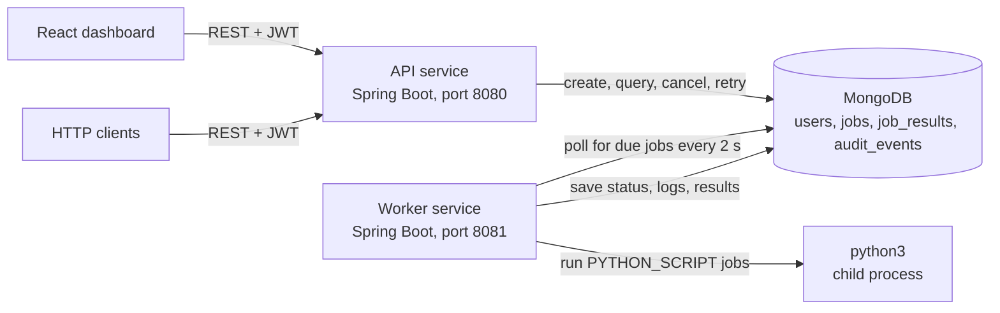
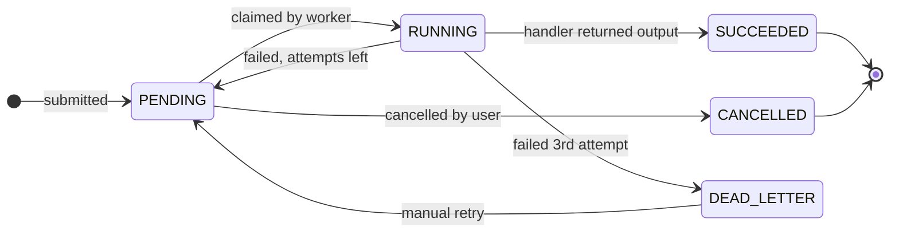

<h1 align="center">FlowForge</h1>

<p align="center">
  <strong>An asynchronous job processing platform with scheduling, automatic retries, and a complete history of every run.</strong>
</p>

<p align="center">
  <a href="https://github.com/ShayaanSadiq/FlowForge/actions/workflows/ci.yml"></a>
  
  
  
  
  <a href="LICENSE"></a>
</p>

<p align="center">
  <a href="#why-i-built-it">Why I built it</a> ·
  <a href="#architecture">Architecture</a> ·
  <a href="#how-the-backend-works">How the backend works</a> ·
  <a href="#getting-started">Getting started</a> ·
  <a href="#using-flowforge">Using FlowForge</a> ·
  <a href="#api-reference">API reference</a> ·
  <a href="#deployment">Deployment</a>
</p>

FlowForge lets users submit work, such as Python scripts or data-processing tasks, through a REST API or a React dashboard. A separate worker service picks up each job, runs it, retries it if it fails, and records its logs, result, timing, and audit trail. The backend is written in Java 21 with Spring Boot and MongoDB, runs locally with a single Docker Compose command, and is configured for deployment on AWS ECS Fargate, MongoDB Atlas, and Vercel.

## Highlights

- **Independent API and worker services.** Two Spring Boot applications share one domain module and communicate only through MongoDB. Jobs are accepted even while the worker is offline and run as soon as it comes back.
- **Enforced job lifecycle.** A state machine guards every transition the worker makes. A failing job gets 3 attempts, then moves to a dead-letter state until someone retries it.
- **Scheduling.** Jobs run immediately, after a delay, or at a specific time up to 7 days ahead.
- **Real code execution.** Python jobs run as separate processes with a 30-second timeout, output limits, and captured stdout and stderr.
- **Production-minded API.** JWT authentication, per-user data isolation, rate limiting, RFC 7807 error responses, request correlation IDs, structured JSON logs, and health checks.
- **Containerized and tested.** Multi-stage Docker images, a one-command local stack, GitHub Actions CI, and deployment configuration for AWS.

## Why I built it

Most web apps finish all of their work inside a single request. I wanted to understand what happens when work doesn't fit in that window: when it is slow, can fail partway through, or needs to run later. CI runners, data pipelines, and ML experiment platforms such as MLflow, Kubeflow, and Airflow all handle this with the same core loop. They accept a job, hand it to a separate executor, and track every run from submission to outcome.

I built FlowForge to implement that loop myself instead of relying on a managed queue, which meant making the decisions such a service usually hides: which state transitions are legal, how many attempts a job gets before it is set aside, how to run user-submitted scripts within time and output limits, and how to trace a single request through the logs. The `PYTHON_SCRIPT` job type has the same shape as an ML experiment run: submit a script, execute it on a worker, and keep its output, logs, duration, and attempt count. I also wanted to own a project end to end, from the data model and API through the dashboard, containers, CI, and cloud deployment.

## Architecture



The backend is a Maven multi-module project that builds two deployable services from a shared library. The API and the worker never call each other. MongoDB is the only thing they share, and the `jobs` collection doubles as the work queue.

| Module | Runs as | Responsibilities |
|--------|---------|------------------|
| `backend/core` | Shared library | Domain model, MongoDB repositories, job service, state machine, scheduling rules, job handlers, Python runner |
| `backend/api` | Spring Boot app on port 8080 | REST controllers, JWT security, rate limiting, correlation IDs, error handling, OpenAPI docs |
| `backend/worker` | Spring Boot app on port 8081 (health checks only) | Polls for due jobs and runs them through the shared executor |

### Design decisions

- **MongoDB is the queue.** A job's record and its place in the queue are the same document, so there is no separate broker to operate and nothing that can drift out of sync with the job history. The trade-off is polling latency: a due job starts within about 2 seconds rather than instantly.
- **Fixed-delay polling in small batches.** The worker waits 2 seconds after finishing a batch before polling again, so batches never overlap, and it runs at most 10 jobs per cycle.
- **One definition of the rules.** The API and worker both depend on `core`, so they use the same entities, repositories, and state machine instead of two copies that have to be kept in sync.
- **Scripts run out of process.** A Python script that crashes or hangs fails its own job, not the worker. A crash surfaces as a non-zero exit code, and a hung script is killed after 30 seconds.

## How the backend works

### Life of a job

1. **Submit.** A client sends `POST /api/jobs` with a job `type`, a `payload`, and optionally `delaySeconds` or `scheduledAt`. The request is authenticated from its JWT, checked against the rate limit, and validated.
2. **Store.** `JobService` works out when the job should run, saves it as `PENDING` with 3 attempts available, and records a `CREATE` audit event. The API responds with `201 Created` straight away; no work happens on the request thread.
3. **Poll.** Every 2 seconds, `JobWorker` queries MongoDB for `PENDING` jobs whose `scheduledAt` time has passed and takes up to 10 of them.
4. **Claim.** Right before running a job, the worker re-reads it and skips it if it is no longer `PENDING` (for example, because the user cancelled it while it waited in the batch). Otherwise the job moves to `RUNNING` and is saved.
5. **Execute.** `JobExecutor` routes the job to the handler for its type. Handlers record timestamped log lines, which are saved with the job when it finishes.
6. **Finish.** On success, the job becomes `SUCCEEDED` with its output, and a `job_results` record stores the output along with metrics (`durationMs`, attempt number, and job type). On failure, the error message is saved and the attempt is counted. The job goes back to `PENDING` for another attempt, or to `DEAD_LETTER` after its third failure.

### Job states



- The worker's transitions go through `JobStateMachine`, which throws on anything not shown above, such as running a job that has already succeeded.
- Cancel and retry check the job's current status first. Cancelling a job that has started, or retrying one that hasn't failed, returns `409 Conflict`.
- `SUCCEEDED` and `CANCELLED` are final. A `DEAD_LETTER` job stays put until `POST /api/jobs/{id}/retry` resets its attempts, logs, and result and queues it again.
- "Scheduled" is not a stored status. A scheduled job is a `PENDING` job whose `scheduledAt` is still in the future, which is why it can be cancelled like any other pending job. The list endpoint and stats still report scheduled jobs separately.

### Scheduling

| Field | Effect | Limits |
|-------|--------|--------|
| `delaySeconds` | Run this many seconds after submission | 0 to 604,800 (7 days) |
| `scheduledAt` | Run at this UTC time, in ISO 8601 format such as `2026-11-01T09:00:00Z` | At most 5 seconds in the past and 7 days in the future |

Send one of these fields or neither; without either, the job runs on the next poll. Sending both returns `400 Bad Request`.

### Job types

| Type | Payload | Result |
|------|---------|--------|
| `PYTHON_SCRIPT` | Python 3 source code | The script's stdout |
| `JSON_FORMAT` | A JSON object or array | The validated, pretty-printed JSON |
| `CSV_ANALYZE` | CSV text with a header row | Row and column counts, empty cells, and the fill rate of each column |
| `HASH_GENERATE` | Plain text, or JSON with `text`, `algorithm` (`SHA-256` or `SHA-512`), `mode` (`single` or `lines`), and an optional `expected` hash | The hash (one per line in `lines` mode), plus a match result when `expected` is given |
| `BASE64_CODEC` | JSON with `operation` (`encode` or `decode`) and `text` | The encoded or decoded text |

The payload is always a string, so structured payloads are JSON encoded inside it:

```json
{
  "type": "HASH_GENERATE",
  "payload": "{\"text\": \"hello\", \"algorithm\": \"SHA-512\"}"
}
```

### How Python jobs run

`PythonScriptRunner` writes the script into a new temporary directory and runs it with `python3` as a separate process.

- stdout and stderr are read concurrently on Java 21 virtual threads, and every line is added to the job's log.
- A script that runs longer than 30 seconds is killed, and the job fails with a timeout error.
- A non-zero exit code fails the job, with stderr included in the error message.
- Scripts can be up to 100,000 characters long, and captured output is capped at 65,536 characters.
- The temporary directory is deleted afterward, whether or not the script succeeded.

Python is installed only in the worker's Docker image. Scripts run with the worker's own permissions rather than in a separate sandbox, so FlowForge is intended for trusted users.

### Data model

| Collection | Contents |
|------------|----------|
| `users` | Email (unique index), BCrypt password hash, and display name |
| `jobs` | Owner, type, payload, status, attempt counts, timestamps, logs, result, and error. Indexed on `userId`, `status`, `scheduledAt`, and a compound `(status, scheduledAt)` index for the worker's poll |
| `job_results` | Output and metrics for each successful run |
| `audit_events` | Registrations, logins, and job creations, retries, and cancellations, each with its user and timestamp |

### Security and observability

- **Authentication.** Stateless JWTs signed with HMAC carry the user's ID and expire after 24 hours. Passwords are stored as BCrypt hashes.
- **Data isolation.** Every job lookup is filtered by the caller's user ID, so requesting another user's job returns `404` and reveals nothing about it.
- **Rate limiting.** Job submission is limited to 30 requests per minute per client IP. Requests over the limit get `429 Too Many Requests` with a `Retry-After` header.
- **Consistent errors.** Errors use RFC 7807 Problem Details: `400` for invalid input, `404` for unknown jobs, and `409` for actions the job's current state doesn't allow.
- **Request tracing.** Every request gets an `X-Correlation-Id`, taken from the incoming header or generated. The ID is attached to every log line for that request and returned in the response.
- **Logging and health.** Under the `prod` profile, the API writes structured JSON logs. Both services expose `/actuator/health` for container health checks.
- **CORS.** Browsers may call the API from `localhost`, `*.vercel.app`, and any origins listed in `FLOWFORGE_CORS_ORIGINS`.

## Getting started

### Run with Docker Compose

The only requirement is Docker with Docker Compose.

```bash
git clone https://github.com/ShayaanSadiq/FlowForge.git
cd FlowForge
docker compose up --build
```

| Service | Address |
|---------|---------|
| Dashboard | http://localhost:3000 |
| REST API | http://localhost:8080 |
| Swagger UI | http://localhost:8080/swagger-ui.html |
| Health check | http://localhost:8080/actuator/health |
| MongoDB | `mongodb://localhost:27017/flowforge` |

Compose starts MongoDB, the API, the worker (with Python 3 installed), and the dashboard served by Nginx. Stop everything with `docker compose down`, and add `-v` to also delete the database volume.

### Run without Docker

You need Java 21, Maven 3.9+, Node.js 20+, and MongoDB running on `localhost:27017`.

```bash
# Terminal 1: install the shared core module, then start the API on :8080
cd backend
mvn install -DskipTests
mvn spring-boot:run -pl api

# Terminal 2: start the worker
cd backend
mvn spring-boot:run -pl worker

# Terminal 3: start the dashboard on :5173 (it proxies /api to :8080)
cd frontend
npm install
npm run dev
```

Python jobs need `python3` on the worker's `PATH`. If your interpreter has a different name, such as `python` on Windows, set the `FLOWFORGE_PYTHON_EXECUTABLE` environment variable.

### Configuration

| Variable | Used by | Default | Purpose |
|----------|---------|---------|---------|
| `SPRING_DATA_MONGODB_URI` | API, worker | `mongodb://localhost:27017/flowforge` | MongoDB connection string |
| `FLOWFORGE_JWT_SECRET` | API | Development-only key | JWT signing key of at least 32 characters; required under the `prod` profile |
| `SPRING_PROFILES_ACTIVE` | API | None | Set to `prod` for JSON logging and a mandatory JWT secret |
| `FLOWFORGE_CORS_ORIGINS` | API | Empty | Extra allowed origins, comma-separated |
| `VITE_API_BASE_URL` | Dashboard build | Empty | API base URL; leave empty in development to use the Vite proxy |

Worker settings, including the poll interval, batch size, and Python limits, are in [`backend/worker/src/main/resources/application.yml`](backend/worker/src/main/resources/application.yml).

## Using FlowForge

### From the dashboard

1. Open http://localhost:3000 and register an account.
2. Click **New Job**, choose a job type, and edit the example payload the form starts with. Optionally schedule it with a delay or a specific time. Press **Ctrl+Enter** (**Cmd+Enter** on macOS) in any field to submit.
3. The dashboard shows job counts by status and a paginated job list that you can filter by status (including *Scheduled*) and type. It refreshes every 5 seconds.
4. Open a job to see its payload, attempts, result or error, and execution logs. Dead-lettered jobs have a **Retry** button, and **Submit similar job** opens the form with the same payload.

### From the API

Swagger UI at http://localhost:8080/swagger-ui.html documents every endpoint; click **Authorize** and paste your token to try them. The same flow with `curl` and `jq`:

```bash
API=http://localhost:8080

# Register and keep the JWT
TOKEN=$(curl -s -X POST "$API/api/auth/register" \
  -H "Content-Type: application/json" \
  -d '{"email": "ada@example.com", "password": "flowforge123", "displayName": "Ada"}' \
  | jq -r .token)

# Submit a Python job that runs 5 seconds from now
JOB_ID=$(curl -s -X POST "$API/api/jobs" \
  -H "Authorization: Bearer $TOKEN" \
  -H "Content-Type: application/json" \
  -d '{"type": "PYTHON_SCRIPT", "payload": "print(sum(range(10)))", "delaySeconds": 5}' \
  | jq -r .id)

# A few seconds later, fetch the job
curl -s "$API/api/jobs/$JOB_ID" -H "Authorization: Bearer $TOKEN" | jq
```

Response (trimmed):

```json
{
  "id": "6710b3f2c9e77a1d4f2b8e10",
  "type": "PYTHON_SCRIPT",
  "status": "SUCCEEDED",
  "logs": [
    "2026-10-16T09:30:07.412873Z | Starting job execution for type: PYTHON_SCRIPT",
    "2026-10-16T09:30:07.413012Z | Running Python script",
    "2026-10-16T09:30:07.415220Z | Writing script to /tmp/flowforge-py-8273645512930477261/script.py",
    "2026-10-16T09:30:07.415301Z | Executing: python3 script.py",
    "2026-10-16T09:30:07.468954Z | stdout | 45",
    "2026-10-16T09:30:07.470118Z | Process exited with code 0",
    "2026-10-16T09:30:07.471020Z | Job completed in 58ms"
  ],
  "result": "45",
  "durationMs": 61
}
```

## API reference

All endpoints except registration, login, health, and the API docs require an `Authorization: Bearer <token>` header.

| Method | Endpoint | Description |
|--------|----------|-------------|
| `POST` | `/api/auth/register` | Create an account and receive a JWT |
| `POST` | `/api/auth/login` | Log in and receive a JWT |
| `GET` | `/api/auth/me` | Current user's profile |
| `POST` | `/api/jobs` | Submit a job, optionally scheduled |
| `GET` | `/api/jobs` | List your jobs. Filter with `status` (including `SCHEDULED`) and `type`; paginate with `page`, `size` (up to 100), and `sort` |
| `GET` | `/api/jobs/{id}` | A job's details, logs, result, and timing |
| `GET` | `/api/jobs/{id}/events` | A job's audit trail |
| `POST` | `/api/jobs/{id}/retry` | Re-queue a dead-lettered job with fresh attempts |
| `POST` | `/api/jobs/{id}/cancel` | Cancel a job that hasn't started |
| `GET` | `/api/stats` | Your job counts by status |
| `GET` | `/actuator/health` | Service health |

## Testing and CI

```bash
cd backend && mvn verify        # JUnit 5 and Mockito tests
cd ../frontend && npm test      # Vitest tests (run npm install first)
```

Backend tests cover the state machine (normal flow, retries into dead letter, rejected transitions, and cancellation), scheduling validation, job filtering and cancellation, per-user stats, payload limits, the Python runner, and the hash handler. Frontend tests cover payload building and parsing, schedule handling, API error parsing, and the submit shortcut.

GitHub Actions runs both test suites, plus a production build of the dashboard, on every push and pull request to `main`.

## Deployment

| Component | Platform | Notes |
|-----------|----------|-------|
| Dashboard | Vercel | Static Vite build; `VITE_API_BASE_URL` points to the API |
| API | AWS ECS Fargate | Behind an Application Load Balancer with HTTPS, health-checked on `/actuator/health` |
| Worker | AWS ECS Fargate | A single task with no load balancer; needs only outbound access to MongoDB |
| Database | MongoDB Atlas | Connection string stored in AWS Secrets Manager |

Both backend images are built from one multi-stage [`backend/Dockerfile`](backend/Dockerfile), where the worker stage adds Python 3, and pushed to Amazon ECR by [`scripts/push-ecr.sh`](scripts/push-ecr.sh). The ECS task definitions in [`.aws/`](.aws) inject secrets from AWS Secrets Manager and ship logs to CloudWatch, and [`scripts/verify-deployment.sh`](scripts/verify-deployment.sh) smoke-tests a running deployment. The full walkthrough is in [docs/DEPLOYMENT.md](docs/DEPLOYMENT.md).

## Tech stack

| Area | Technologies |
|------|--------------|
| Backend | Java 21, Spring Boot 3.3, Spring Security, Spring Data MongoDB, JJWT, springdoc-openapi, Lombok |
| Frontend | React 18, Vite, Material UI, React Router |
| Database | MongoDB 7, MongoDB Atlas |
| Infrastructure | Docker, Docker Compose, Nginx, AWS ECS Fargate, Amazon ECR, AWS Secrets Manager, Amazon CloudWatch, Vercel |
| Testing and CI | JUnit 5, Mockito, Vitest, GitHub Actions |

## Project structure

```text
FlowForge/
├── backend/
│   ├── core/            # Domain model, repositories, services, state machine, job handlers
│   ├── api/             # REST API: controllers, security, rate limiting, error handling
│   ├── worker/          # Scheduled job poller
│   └── Dockerfile       # Multi-stage build for the api and worker images
├── frontend/            # React + Vite + Material UI dashboard
├── .aws/                # ECS task definitions
├── scripts/             # ECR push and deployment smoke test
├── docs/                # Deployment guides
├── .github/workflows/   # CI pipeline
└── docker-compose.yml   # Local full stack
```

## License

Released under the [MIT License](LICENSE).
